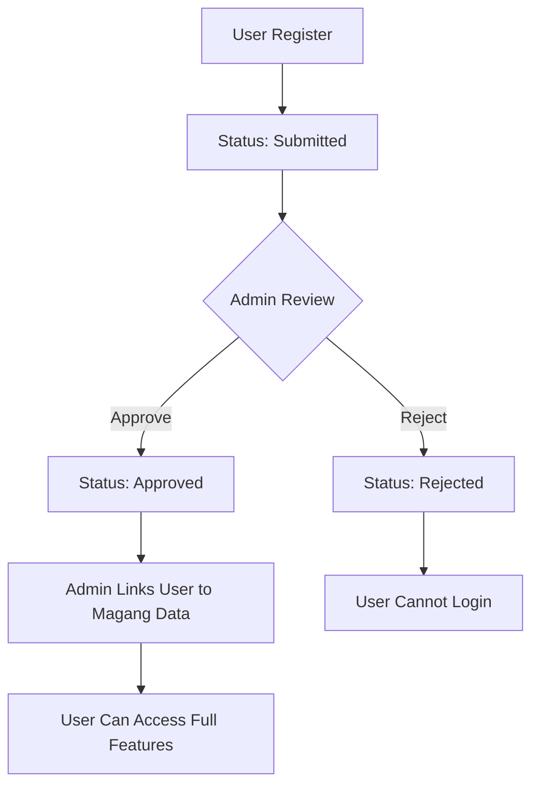

# 📋 **Website Magang - Sistem Manajemen Magang**

[](https://laravel.com)
[](https://php.net)
[](LICENSE)
[]()

> **Sistem manajemen magang digital untuk mengelola peserta magang, laporan harian, dan monitoring aktivitas magang secara real-time.**

## 📑 **Table of Contents**

-   📋 Overview
-   ✨ Features
-   🛠️ Tech Stack
-   📋 Requirements
-   🚀 Quick Start
-   ⚙️ Installation
-   🔧 Configuration
-   📖 Usage
-   🏗️ Project Structure
-   🔐 Authentication
-   📊 API Reference
-   🧪 Testing
-   🚀 Deployment
-   🤝 Contributing
-   📄 License
-   💬 Support

## 📋 **Overview**

Website Magang adalah aplikasi web berbasis Laravel yang dirancang untuk digitalisasi proses manajemen magang. Sistem ini memungkinkan admin untuk mengelola peserta magang dan mahasiswa untuk melaporkan aktivitas harian mereka secara digital.

### **Problem Statement**

-   Proses pencatatan laporan magang masih manual
-   Sulit memantau progress peserta magang
-   Tidak ada sistem terpusat untuk manajemen data magang

### **Solution**

-   Dashboard terintegrasi untuk admin dan mahasiswa
-   Sistem pelaporan digital dengan upload bukti foto
-   Real-time monitoring dan statistik
-   Export laporan dalam format Excel/PDF

## ✨ **Features**

### 👨‍💼 **Admin Features**

-   ✅ **User Management** - Kelola akun mahasiswa (approve/reject)
-   📊 **Dashboard Analytics** - Statistik real-time peserta magang
-   👥 **Mahasiswa Management** - CRUD data peserta magang
-   📈 **Progress Monitoring** - Monitor laporan harian mahasiswa
-   📑 **Report Export** - Export data ke Excel/PDF
-   🔗 **User Linking** - Hubungkan akun user dengan data magang

### 👨‍🎓 **Student Features**

-   📝 **Daily Reports** - Submit laporan tugas harian
-   📸 **Photo Upload** - Upload bukti foto kegiatan
-   📊 **Personal Dashboard** - Lihat progress pribadi
-   👤 **Profile Management** - Kelola profil dan data pribadi

### 🔒 **Security Features**

-   Role-based access control (Admin/Student)
-   Status-based account approval system
-   File upload validation and security
-   Session management

## 🛠️ **Tech Stack**

| Category            | Technology                   |
| ------------------- | ---------------------------- |
| **Backend**         | Laravel 12.0, PHP 8.2+       |
| **Database**        | MySQL 8.0+ / PostgreSQL      |
| **Frontend**        | Blade Templates, Bootstrap 5 |
| **File Processing** | Laravel Excel, DomPDF        |
| **Authentication**  | Laravel Sanctum              |
| **Storage**         | Laravel File Storage         |
| **Build Tools**     | Vite, NPM                    |

## 📋 **Requirements**

### **System Requirements**

-   **PHP** >= 8.2
-   **Composer** >= 2.0
-   **Node.js** >= 18.x
-   **NPM** >= 8.x
-   **MySQL** >= 8.0 or **PostgreSQL** >= 13

### **PHP Extensions**

```
- OpenSSL PHP Extension
- PDO PHP Extension
- Mbstring PHP Extension
- Tokenizer PHP Extension
- XML PHP Extension
- Ctype PHP Extension
- JSON PHP Extension
- BCMath PHP Extension
- GD PHP Extension
- Fileinfo PHP Extension
```

## 🚀 **Quick Start**

```bash
# Clone repository
git clone https://github.com/your-username/website-magang.git
cd website-magang

# Install dependencies
composer install && npm install

# Setup environment
cp .env.example .env
php artisan key:generate

# Setup database
php artisan migrate --seed

# Build assets and run
npm run dev
php artisan serve
```

🎉 **Your application is now running at [http://localhost:8000](http://localhost:8000)**

**Default Admin Login:**

-   Email: `admin@kominfo.go.id`
-   Password: `password`

## ⚙️ **Installation**

### **Step 1: Clone Repository**

```bash
git clone https://github.com/your-username/website-magang.git
cd website-magang
```

### **Step 2: Install Dependencies**

```bash
# PHP dependencies
composer install

# JavaScript dependencies
npm install
```

### **Step 3: Environment Setup**

```bash
# Copy environment file
cp .env.example .env

# Generate application key
php artisan key:generate

# Create storage symbolic link
php artisan storage:link
```

### **Step 4: Database Setup**

```bash
# Create database
mysql -u root -p -e "CREATE DATABASE website_magang;"

# Run migrations and seeders
php artisan migrate --seed
```

### **Step 5: Build Assets**

```bash
# For development
npm run dev

# For production
npm run build
```

### **Step 6: Set Permissions** _(Linux/Mac only)_

```bash
chmod -R 775 storage bootstrap/cache
```

## 🔧 **Configuration**

### **Environment Variables**

```env
# Application
APP_NAME="Website Magang"
APP_ENV=local
APP_KEY=base64:your_generated_key
APP_DEBUG=true
APP_URL=http://localhost:8000

# Database
DB_CONNECTION=mysql
DB_HOST=127.0.0.1
DB_PORT=3306
DB_DATABASE=website_magang
DB_USERNAME=root
DB_PASSWORD=

# Mail (Optional)
MAIL_MAILER=smtp
MAIL_HOST=smtp.gmail.com
MAIL_PORT=587
MAIL_USERNAME=your-email@gmail.com
MAIL_PASSWORD=your-app-password
MAIL_ENCRYPTION=tls

# File Storage
FILESYSTEM_DISK=local

# Session
SESSION_DRIVER=file
SESSION_LIFETIME=120
```

### **Database Configuration**

| Option          | Description     | Default        |
| --------------- | --------------- | -------------- |
| `DB_CONNECTION` | Database driver | mysql          |
| `DB_HOST`       | Database host   | 127.0.0.1      |
| `DB_PORT`       | Database port   | 3306           |
| `DB_DATABASE`   | Database name   | website_magang |

## 📖 **Usage**

### **Admin Workflow**

1. **Login** menggunakan akun admin
2. **Approve Users** - Setujui pendaftaran mahasiswa
3. **Link Users** - Hubungkan akun dengan data magang
4. **Monitor Progress** - Pantau laporan harian
5. **Export Reports** - Download laporan dalam Excel/PDF

### **Student Workflow**

1. **Register** akun baru
2. **Wait for Approval** dari admin
3. **Complete Profile** setelah disetujui
4. **Submit Daily Reports** dengan foto bukti
5. **Track Progress** melalui dashboard

### **API Usage Examples**

```php
// Get active students
$students = AnakMagang::where('status', 'active')->get();

// Create submission
$submission = Submission::create([
    'user_id' => auth()->id(),
    'judul_tugas' => 'Task Title',
    'deskripsi' => 'Task Description',
    'tanggal' => now()
]);

// Upload submission images
foreach ($request->file('images') as $image) {
    SubmissionImage::create([
        'submission_id' => $submission->id,
        'image_path' => $image->store('submissions')
    ]);
}
```

## 🏗️ **Project Structure**

```
website-magang/
├── app/
│   ├── Http/
│   │   ├── Controllers/
│   │   │   ├── Admin/          # Admin controllers
│   │   │   └── User/           # User controllers
│   │   ├── Middleware/         # Custom middleware
│   │   └── Requests/           # Form requests
│   ├── Models/                 # Eloquent models
│   └── Services/               # Business logic
├── database/
│   ├── migrations/             # Database migrations
│   ├── seeders/               # Data seeders
│   └── factories/             # Model factories
├── resources/
│   ├── views/
│   │   ├── admin/             # Admin views
│   │   ├── user/              # User views
│   │   └── layouts/           # Layout templates
│   ├── js/                    # JavaScript assets
│   └── css/                   # CSS assets
├── routes/
│   ├── web.php                # Web routes
│   └── api.php                # API routes
├── storage/
│   ├── app/
│   │   ├── public/
│   │   │   ├── profile-images/ # Profile pictures
│   │   │   ├── surat-validasi/ # Validation letters
│   │   │   └── submission-images/ # Task images
├── public/                    # Public assets
└── tests/                     # Test files
```

## 🔐 **Authentication**

### **User Roles**

| Role        | Permissions                              |
| ----------- | ---------------------------------------- |
| **Admin**   | Full access to all features              |
| **Student** | Limited to personal data and submissions |

### **Authentication Flow**



### **Protected Routes**

```php
// Admin only routes
Route::middleware(['auth', 'role:admin'])->prefix('admin')->group(function () {
    Route::get('/dashboard', [AdminController::class, 'dashboard']);
    Route::resource('anak-magang', AnakMagangController::class);
});

// Student only routes
Route::middleware(['auth', 'role:user'])->prefix('user')->group(function () {
    Route::get('/dashboard', [UserController::class, 'dashboard']);
    Route::resource('submissions', SubmissionController::class);
});
```

## 📊 **API Reference**

### **Authentication Endpoints**

| Method | Endpoint        | Description       |
| ------ | --------------- | ----------------- |
| POST   | `/api/login`    | User login        |
| POST   | `/api/register` | User registration |
| POST   | `/api/logout`   | User logout       |

### **Admin Endpoints**

| Method | Endpoint                           | Description              |
| ------ | ---------------------------------- | ------------------------ |
| GET    | `/api/admin/students`              | Get all students         |
| POST   | `/api/admin/students/{id}/approve` | Approve student          |
| GET    | `/api/admin/submissions`           | Get all submissions      |
| GET    | `/api/admin/stats`                 | Get dashboard statistics |

### **Student Endpoints**

| Method | Endpoint                            | Description              |
| ------ | ----------------------------------- | ------------------------ |
| GET    | `/api/user/profile`                 | Get user profile         |
| POST   | `/api/user/submissions`             | Create submission        |
| GET    | `/api/user/submissions`             | Get user submissions     |
| POST   | `/api/user/submissions/{id}/images` | Upload submission images |

## 🧪 **Testing**

### **Run Tests**

```bash
# Run all tests
php artisan test

# Run specific test suite
php artisan test --testsuite=Feature

# Run with coverage
php artisan test --coverage
```

### **Test Structure**

```
tests/
├── Feature/
│   ├── AdminTest.php
│   ├── AuthTest.php
│   ├── SubmissionTest.php
│   └── UserTest.php
├── Unit/
│   ├── ModelTest.php
│   └── ServiceTest.php
└── TestCase.php
```

### **Writing Tests**

```php
class SubmissionTest extends TestCase
{
    public function test_user_can_create_submission()
    {
        $user = User::factory()->create();

        $response = $this->actingAs($user)
            ->post('/user/submissions', [
                'judul_tugas' => 'Test Task',
                'deskripsi' => 'Test Description'
            ]);

        $response->assertRedirect();
        $this->assertDatabaseHas('submissions', [
            'judul_tugas' => 'Test Task'
        ]);
    }
}
```

## 🚀 **Deployment**

### **Production Environment**

```bash
# Build production assets
npm run build

# Optimize Laravel
php artisan config:cache
php artisan route:cache
php artisan view:cache

# Set production environment
APP_ENV=production
APP_DEBUG=false
```

### **Docker Deployment**

```dockerfile
FROM php:8.2-fpm

# Install dependencies
RUN apt-get update && apt-get install -y \
    git curl libpng-dev libonig-dev libxml2-dev zip unzip

# Install PHP extensions
RUN docker-php-ext-install pdo_mysql mbstring exif pcntl bcmath gd

# Install Composer
COPY --from=composer:latest /usr/bin/composer /usr/bin/composer

# Set working directory
WORKDIR /var/www

# Copy application
COPY . .

# Install dependencies
RUN composer install --no-dev --optimize-autoloader

# Set permissions
RUN chown -R www-data:www-data /var/www
```

### **Server Requirements**

| Component   | Minimum | Recommended |
| ----------- | ------- | ----------- |
| **CPU**     | 1 core  | 2+ cores    |
| **RAM**     | 512MB   | 2GB+        |
| **Storage** | 1GB     | 10GB+       |
| **PHP**     | 8.2     | 8.3+        |

## 🤝 **Contributing**

We welcome contributions! Please follow these guidelines:

### **Development Workflow**

1. **Fork** the repository
2. **Create** a feature branch (`git checkout -b feature/amazing-feature`)
3. **Commit** your changes (`git commit -m 'Add amazing feature'`)
4. **Push** to the branch (`git push origin feature/amazing-feature`)
5. **Open** a Pull Request

### **Coding Standards**

-   Follow **PSR-12** coding standards
-   Write **PHPDoc** comments for all methods
-   Include **tests** for new features
-   Follow **Laravel conventions**

### **Commit Message Format**

```
feat: add new submission feature
fix: resolve login redirect issue
docs: update installation guide
style: format code according to PSR-12
refactor: optimize database queries
test: add unit tests for user model
```

## 📄 **License**

This project is licensed under the MIT License - see the LICENSE file for details.

```
MIT License

Copyright (c) 2025 Website Magang

Permission is hereby granted, free of charge, to any person obtaining a copy
of this software and associated documentation files (the "Software"), to deal
in the Software without restriction...
```

## 💬 **Support**

### **Getting Help**

-   📚 **Documentation**: [Full Documentation](https://github.com/your-username/website-magang/wiki)
-   🐛 **Bug Reports**: [GitHub Issues](https://github.com/your-username/website-magang/issues)
-   💬 **Discussions**: [GitHub Discussions](https://github.com/your-username/website-magang/discussions)
-   📧 **Email**: support@website-magang.com

### **FAQ**

**Q: Bagaimana cara reset password admin?**
A: Gunakan command `php artisan tinker` dan reset manual melalui database.

**Q: File upload tidak berfungsi?**
A: Pastikan symbolic link storage sudah dibuat dengan `php artisan storage:link`.

**Q: Database connection error?**
A: Periksa konfigurasi .env dan pastikan database server berjalan.

---

### **Project Status**

-   ✅ **Active Development**
-   🔄 **Version**: 1.0.0
-   📅 **Last Updated**: July 19, 2025
-   👥 **Contributors**: 2
-   ⭐ **Stars**: 0
-   🍴 **Forks**: 0

---

**Made with ❤️ by Anak Magang POLINES**
